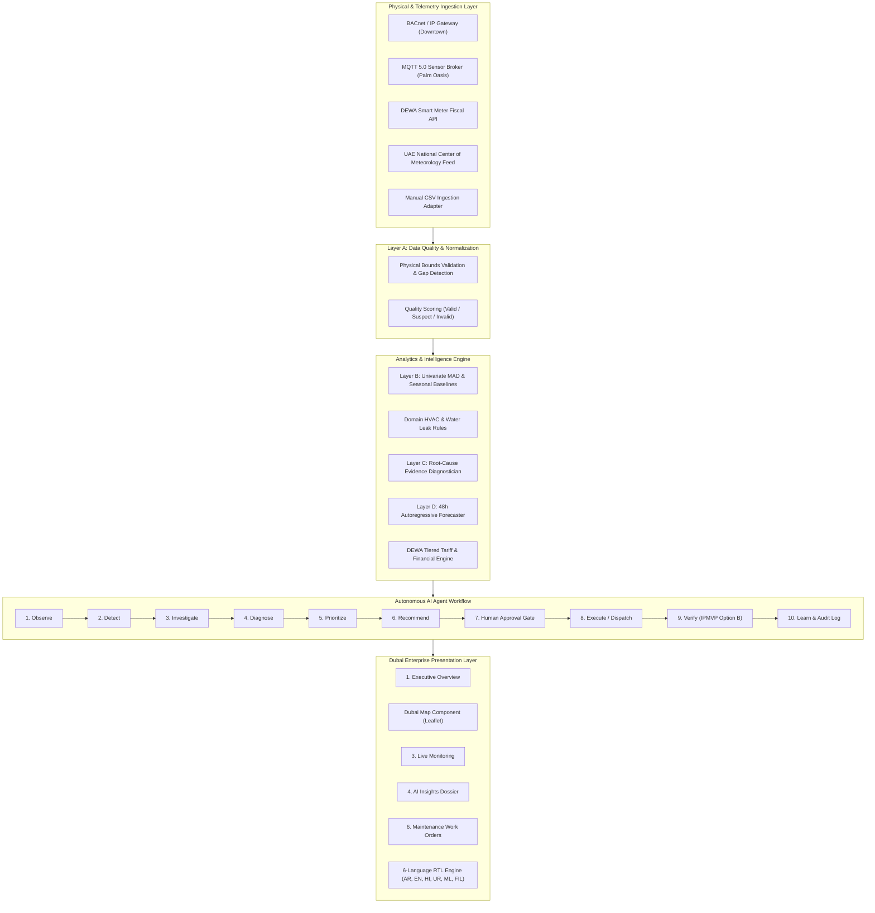

# CoolShield AI — Architecture & System Design
**Dubai Smart Building Operations & Autonomous Efficiency Agent**

---

## 1. System Overview & Architecture

CoolShield AI is an autonomous building operations system designed specifically for commercial office towers, luxury hotels, residential high-rises, and mixed-use retail developments in Dubai.

---

## 2. Layered Analytical Pipeline

1. **Layer A — Data Quality Validation:**
   - Evaluates physical sensor ranges (e.g., negative electricity or water is flagged invalid).
   - Monitors for flatlined telemetry (zero standard deviation over $\ge 12$ consecutive readings).
   - Tracks packet dropouts and sensor communication timeouts.

2. **Layer B — Statistical & Domain Detection:**
   - 7-day (168-hour) rolling median and Median Absolute Deviation (MAD) with $k = 4.2$.
   - Diurnal and weekday-vs-weekend seasonal profiles.
   - Domain-specific heuristics: Continuous unmitigated night water flow; Low Delta-T Syndrome on chillers; After-hours high VAV fan runtime during zero occupancy.

3. **Layer C — Root Cause Diagnostics:**
   - Synthesizes telemetry across chilled water loops, air dampers, and fiscal sub-meters.
   - Calculates calibrated confidence scores ($0.0 - 1.0$) with evidence rationales.
   - Ranks probable causes based on evidence strength (e.g., pipe rupture vs. solenoid valve failure vs. meter calibration drift).

4. **Layer D — Consumption Forecasting:**
   - 48-hour hourly autoregressive projection with 90% prediction intervals ($z = 1.645$).
   - Flags when historical data is insufficient ($< 72$ hours).

---

## 3. Human Approval Gate & Safety Protocols

Physical building infrastructure control (direct BACnet write commands to VAVs, chillers, or booster valves) is **explicitly disabled** in the MVP.
All consequential operational actions require:
- **Role-Based Authorization (RBAC)** enforced at the API layer.
- **Facilities Manager Approval** before work orders transition to `Assigned`.
- **Tamper-Evident Audit Logging** recording actor, timestamp, and rationale.

---

## 4. Verification Engine (IPMVP Option B)

To avoid claiming unverified modeled savings as actual savings:
$$\text{Avoided Cost (AED)} = (\text{Pre-Intervention Rate} - \text{Post-Intervention Rate}) \times \Delta t \times \text{DEWA Tariff}$$
The autonomous agent only marks a work order as `Resolved` once post-action telemetry confirms consumption has returned within $\pm 2\%$ of the weather-adjusted baseline.
